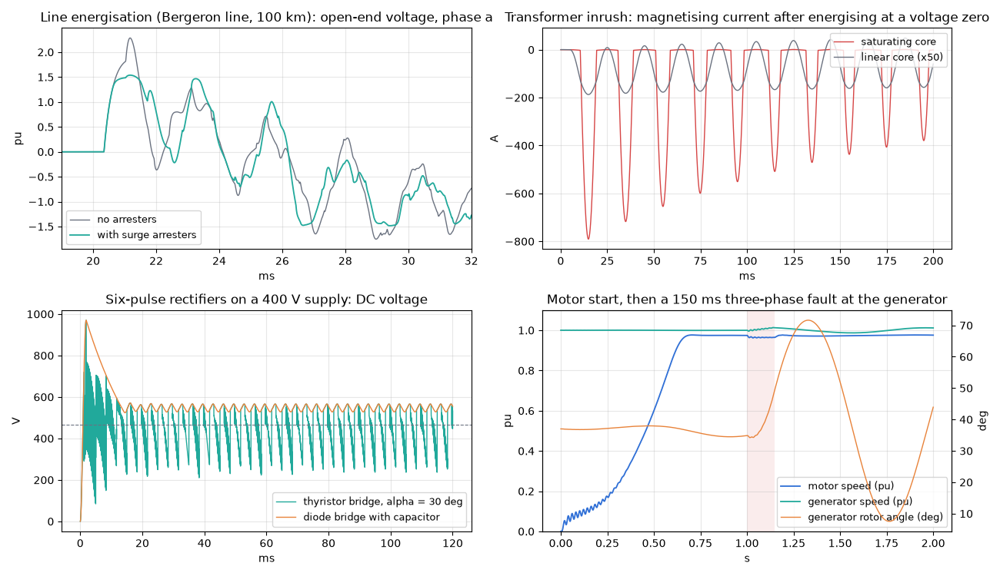

<p align="center">
  <picture>
    <source media="(prefers-color-scheme: dark)" srcset="docs/logo-dark.svg">
    
  </picture>
</p>

**EMTSim** is a small electromagnetic transients (EMT) simulator, written in both **C++** and **Python**. It implements Dommel's nodal method: the same time-domain algorithm that runs underneath tools such as PSCAD/EMTDC and EMTP, kept small enough to read in one sitting.

It started as a learning project to understand what happens inside an EMT engine. Every step of the algorithm is a separate, commented method, so you can follow a simulation one time step at a time. The two versions implement the same algorithm with the same method names, and they produce the same results to within floating-point round-off, so you can read one alongside the other. The C++ solver is plain C++17 with no external libraries.

<p align="center">
  
</p>
<p align="center"><sub>Example network in <code>src/circuit.cpp</code>: 8 nodes fed by two 230 V, 50 Hz sources (one Norton, one ideal, 15° apart). A bolted fault at bus 6 is applied at 20 ms and cleared at 40 ms. Breaker SW1 then opens at 55 ms, splitting the network in two, and recloses at 80 ms. Bus 6 collapses during the fault and spikes when it clears, and the capacitive buses ring after each event.</sub></p>

## Features

- R, L and C elements using trapezoidal-rule companion models
- Sinusoidal voltage sources: ideal, Norton, or behind a series R-L or a three-phase sequence impedance
- Time-controlled switches (breakers) and faults; breakers can open at the next current zero. The conductance matrix is rebuilt and refactorised only when something switches.
- Coupled three-phase R-L branches and nominal-pi lines (sequence data), and Bergeron travelling-wave lines (single- and three-phase)
- Single- and three-phase transformers (vector groups YNyn0, YNd1, YNd11, Dyn1, Dyn11, Yy0, Dd0), with optional core saturation
- Non-linear elements: saturable inductor and metal-oxide surge arrester, solved by re-solving each step until their states settle
- Power electronics: diodes and thyristors with firing-angle control
- Machines: synchronous generator (classical model with swing equation) and induction motor
- Branch currents of every element are recorded, together with machine speed, rotor angle, power and torque
- Nodes can be numbered freely; source nodes are reordered automatically
- Writes every node voltage and branch current to CSV, and `plot.py` plots them with fault periods and switch operations marked
- C++ version is self-contained, with no dependencies: a sparse conductance matrix factorised by a sparse LDLᵀ with minimum-degree ordering, so it scales to large networks
- **Circuit editor** in the browser: draw a circuit, run it with C++ or Python (or both) and see every node voltage
- **Three-phase mode** in the editor: three-phase wires, R, L, C, sources, switches (poles together or independent) and faults (a-g … abc-g)
- Circuits can be defined in code or in a plain-text **netlist file** that both versions read
- `compare.py` runs both versions and compares their results and speed
- Plots switch to a grid of small multiples for large networks (all 100 nodes of the test network on one figure)

## Quick start

```bash
git clone https://github.com/realamilapathirana/EMTSIM.git
cd EMTSIM
pip install -r requirements.txt     # numpy, scipy, matplotlib
```

### C++ version

**You need:**
- A C++17 compiler: Visual Studio 2019 or later with "Desktop development with C++", GCC or Clang.
- CMake 3.15 or later. Visual Studio's C++ tools include it.

**Windows:** `run.bat` finds Visual Studio, builds the project, runs the tests and the simulation, then opens the plot. In VS Code, **Ctrl+Shift+B** runs `build.bat`.

```bat
run.bat
```

**Any platform, step by step:**

```bash
cmake -S . -B build -DCMAKE_BUILD_TYPE=Release
cmake --build build --config Release
ctest --test-dir build -C Release      # analytical tests
./build/emtsim                         # Windows (Visual Studio generator): build\Release\emtsim.exe
./build/emtsim circuits/grid100.net    # or a netlist file
python plot.py                         # or: python plot.py --save plot.png
```

The C++ simulator writes `results.csv` (time and V1…Vn), `currents.csv` (branch currents and machine quantities) and `events.csv` (fault and switch times) to the current directory, and `plot.py` plots the voltages. To change the built-in circuit, edit [`src/circuit.cpp`](src/circuit.cpp) and rebuild. The default time step and simulation length are in [`src/config.h`](src/config.h); a netlist can set its own with a `.tran dt tstop` line.

### Python version

```bash
python main.py                         # circuit in dataloader.py
python main.py circuits/grid100.net    # or a netlist file
```

A window opens with one plot per node. The circuit is in [`dataloader.py`](dataloader.py), and the time step and simulation length are in [`config.py`](config.py).

### Compare the two

Build the C++ version first, then run:

```bash
python compare.py --netlist circuits/grid100.net          # speed and accuracy on the 100-node network
python compare.py --netlist circuits/grid100.net --plot   # overlay both versions and plot their difference
python compare.py                                          # built-in circuits (dataloader.py vs src/circuit.cpp)
```

With `--netlist`, both versions read the same file, so they are guaranteed to simulate the same circuit. Without it, each version uses its own built-in circuit, so keep `dataloader.py` and `src/circuit.cpp` in sync. Timing is the best of `--repeat` runs (default 3). It covers reading the circuit, building the network and the time loop, but not process start, plotting or writing results.

Results on a Windows laptop (1,000 time steps at Δt = 100 µs, MSVC 2019 Release build, Python 3.13 with numpy and scipy):

| Circuit | Python | C++ | Speed-up | Max \|Python − C++\| |
|---|---|---|---|---|
| 8 nodes, 14 elements (built-in example) | 94 ms | 1.6 ms | 61× | 1.2×10⁻¹² V |
| 100 nodes, 198 elements ([`circuits/grid100.net`](circuits/grid100.net)) | 703 ms | 12 ms | 60× | 1.8×10⁻¹⁰ V (2×10⁻¹³ of peak) |
| 1013 nodes, 1997 elements ([`circuits/grid1000.net`](circuits/grid1000.net)) | 7.5 s | 131 ms | 58× | 1.9×10⁻¹⁰ V (2×10⁻¹³ of peak) |

The results are not bit-identical, because the two versions solve the network equations in a different order: Python uses scipy's dense LAPACK LU, C++ a sparse LDLᵀ with its own node ordering. The differences are round-off, about 10⁻¹³ of the signal.

**Why the C++ version scales:** the conductance matrix is very sparse (the 1013-node network's G_UU has 2,975 non-zeros out of a million entries). The C++ version stores it as a sparse matrix, reorders the nodes with a minimum-degree ordering and factorises it with a sparse LDLᵀ (G_UU is symmetric positive definite, so no pivoting is needed). The factor L has only 1,231 non-zeros below the diagonal, so each factorisation and each time step's solve costs a few thousand operations instead of the 3.5×10⁸ and 2×10⁶ of a dense LU. With the earlier dense LU, the 1013-node case took 5.0 s in C++, only 1.5× faster than Python.

### The 1013-node example

[`circuits/grid1000.net`](circuits/grid1000.net) is generated by [`circuits/make_grid1000.py`](circuits/make_grid1000.py). It joins 10 copies ("areas") of the 100-node network, drawn in 2 rows of 5, with 13 tie lines (1 Ω + 10 mH) between neighbouring areas:

```
A1 -- A2 -- A3 -- A4 -- A5
|     |     |     |     |
A6 -- A7 -- A8 -- A9 -- A10
```

- **Power flow:** the generator angles of each area are shifted by −2° from the previous one, so power flows through the ties.
- **Events:** only area A1 has the fault and the switching sequence. In A2–A10 the switches never operate, so the case shows how far a disturbance in one area travels.
- **Names:** element names start with the area (`A3.R_B1-B2`, `A7.G5`, `TIE_A2-A3.R`).

It opens in the circuit editor with its full drawing. Use **Fit** to see all ten areas. The Results tab plots the first 60 nodes; type ranges such as `100-160` in **Show nodes** to see others.

### The 100-node test network

[`circuits/grid100.net`](circuits/grid100.net) is generated by [`circuits/make_grid100.py`](circuits/make_grid100.py), which places every element on the editor's grid and then builds the netlist from that drawing with the editor's own code (this needs Node.js). So the network opens in the circuit editor with a full schematic: the ring along the middle with its return section across the top, generators above their buses, and feeders hanging below. It contains:

- a meshed ring of 12 buses, made of R–L sections with line-charging capacitance;
- 15 generators: 12 Norton sources and 3 ideal grid infeeds, each behind a transformer inductance, with slightly different voltages and angles;
- 6 radial feeders of 5 load buses each, with resistive, inductive (motor) and capacitive (power-factor correction) loads;
- a switched 150 µF capacitor bank.

In total there are 73 R, 74 L, 29 C, 15 sources, 6 switches and 1 fault.

| Time | Event |
|---|---|
| 20 ms | Bolted fault on feeder 4, bus 3 |
| 30 ms | Feeder 4 breaker trips |
| 40 ms | Capacitor bank energised on B3 |
| 45 ms | Fault extinguishes |
| 50 ms | Ring tie B6–B7 opens |
| 55 ms | Feeder 1 breaker trips |
| 65 ms | Generator G7 breaker trips |
| 70 ms | Feeder 4 recloses |
| 75 ms | Feeder 1 recloses |
| 85 ms | Ring tie B6–B7 recloses |
| 90 ms | Ring tie B12–B1 opens |

Each breaker has 10 µF ∥ 100 Ω to ground on its line side, representing terminal stray capacitance and losses. Without it, the node between an opened breaker and a line inductance is connected only to the inductor and the open switch. The trapezoidal rule then produces a sustained, step-by-step numerical oscillation ("chatter") rather than a physical transient.

## Circuit editor

<p align="center"></p>

Start the editor with:

```powershell
.\gui.bat                 # or: .venv\Scripts\python gui\server.py
```

It opens in your browser at `http://127.0.0.1:8765`. Press **Ctrl+C** in the terminal to stop it. The server only listens on your own computer.

- **Draw:** pick a component on the left, then click on the grid to place it. Press **R** to rotate before or after placing.
- **Wire:** use the **Wire** tool (**W**). Click to start, click to add corners, and finish on a terminal or another wire, or press **Esc**. A wire that ends on another wire joins it; wires that only cross do not.
- **Ground:** every circuit needs at least one ground symbol, which is node 0.
- **Edit:** select a component to change its name and values in the right-hand panel. Values accept SI prefixes: `3m`, `30u`, `4.7k`, `20ms`.
- **Move and delete:** drag a component to move it; wires attached to its terminals follow. **Del** deletes, **Ctrl+Z** and **Ctrl+Y** undo and redo, the mouse wheel zooms, and dragging the background pans.
- **Node numbers:** they are assigned automatically, left to right, and shown as teal badges. They are the V1, V2… in the plots.
- **Problems:** short-circuited parts, unconnected terminals (red ring), a missing ground and ideal sources without a grounded terminal are listed in the right panel and the **Netlist** tab.
- **Run (F5):** runs the C++ or Python simulator, or **Both (compare)**, and plots every node voltage, with faults shaded and switch operations dashed. Hover over a plot to read values. In compare mode the summary shows both run times, the speed-up and the largest Python − C++ difference.
- **Currents:** choose *Currents* above the plots to see the branch current of every element, and the machines' speed, rotor angle, power and torque. Type part of a name in *Show* to filter.
- **Run settings:** with nothing selected, the right panel has the time step and duration of the run (written into the file as a `.tran` line).
- **More components:** lines (π and Bergeron), transformers, surge arresters, and diodes and thyristors (single-phase mode) or the coupled R-L branch and the generator and motor (three-phase mode). Breakers can open at a current zero, and sources can have an internal inductance (sequence impedance for three-phase sources).
- **Save (Ctrl+S):** writes `circuits/<name>.net`, an ordinary netlist that also runs with `.\run.bat circuits\<name>.net`. The drawing is stored in a `#@layout` comment line, so **Open…** can bring it back. Netlists without a drawing (for example hand-written ones) can be opened and run but not edited.

The editor is [`gui/index.html`](gui/index.html) (plain JavaScript and SVG, no downloads), [`gui/schematic.js`](gui/schematic.js) (drawing → netlist, tested with `node gui/test_schematic.js`) and [`gui/server.py`](gui/server.py) (Python standard library only).

### Three-phase mode

<p align="center"></p>

Choose **3-phase** in the selector at the top of the editor. Single-phase mode is unchanged. In three-phase mode:

- **Wires and buses** carry phases a, b and c, and are drawn thicker with the "///" mark. Three-phase components carry the same mark.
- **R, L, C:** the value applies to each phase.
- **Sources** are positive sequence: you set the peak phase-to-ground voltage and the angle of phase a, and b = a − 120°, c = a + 120°. As in single-phase mode, a source is Norton if it has an internal resistance and ideal otherwise.
- **Switches:** set **Poles** to *together* for one state and one list of switching times, or to *independent* for a state and switching times per pole. Independent poles are useful for modelling poles that open at successive current zeros.
- **Faults** attach to a bus. The types are `a-g`, `b-g`, `c-g`, `ab`, `bc`, `ca`, `ab-g`, `bc-g`, `ca-g`, `abc` and `abc-g`, where `-g` means to ground. The phases can be applied and cleared *together* or at *independent* times. A phase-to-phase fault connects consecutive phases (`abc` = a–b and b–c).
- **Plots:** each card shows one three-phase node with phases a, b and c in red, amber and blue. **Show nodes** filters by three-phase node number.
- **Changing the mode** converts the drawing: every part becomes its three-phase (or single-phase) version with the same values. **Ctrl+Z** undoes the conversion.

The editor writes an ordinary single-phase netlist with three elements per part (names ending in `.a`, `.b`, `.c`). Node *k* of the drawing becomes netlist nodes 3k−2 (a), 3k−1 (b) and 3k (c). So the C++ and Python simulators, `run.bat` and `compare.py` run three-phase circuits unchanged.

**Coupling between phases:** R, L, C, sources without impedance, switches and faults are modelled per phase. For realistic unbalanced studies, use the coupled parts: *Coupled RL*, *Line π* and *Line TL* in three-phase mode, a three-phase source with sequence impedance (L1, R0, L0), three-phase transformers and machines. With those, the healthy phases rise during a single-line-to-ground fault as they do in a real system.

[`circuits/example3ph.net`](circuits/example3ph.net) is a small three-phase example, generated by [`circuits/make_example3ph.py`](circuits/make_example3ph.py):
- a source and line feeding a load bus;
- a single-line-to-ground fault on phase a from 40 to 70 ms;
- a breaker to a motor feeder whose poles open independently at 80, 83.3 and 86.7 ms.

Before the fault, Va + Vb + Vc = 0 at every bus to within 10⁻¹² V. The only exception is the open fault's 1 MΩ "off" resistance, which sits on phase a only and unbalances it by about 1 mV.

## Defining a circuit

Node `0` is ground, and other nodes are numbered `1, 2, 3, ...`.

**Netlist file:** both versions can read a plain-text netlist (`emtsim file.net`, `python main.py file.net`), so one file defines the circuit for both. Put one element per line, and use `#` to start a comment. The first word of the comment names the element in the recorded currents:

```
.tran 50e-6 0.2                # time step and duration (s); before the elements; default 100 us, 0.1 s
R  1 2  0.2                    # R12      from to ohm
L  2 3  3e-3                   # L23      from to henry
C  3 0  30e-6                  # C1       from to farad
V  0 1  325 0 50 0.1           # VS1      from to peak-V angle(deg) Hz [resistance]; no resistance = ideal
SW 3 4  closed 0.055 0.080     # SW1      from to closed|open, then switching times (s)
F  6 0  0.020 0.040            # F1       from to t_apply [t_clear]
```

The readers are [`netlist.py`](netlist.py) and [`src/netlist.cpp`](src/netlist.cpp).

### Element reference

Optional parameters are in brackets and can also be given as `key=value`. Three-phase elements list the nodes of phases a, b, c.

| Element | Netlist line | Notes |
|---|---|---|
| Resistor, inductor, capacitor | `R a b ohm`, `L a b henry`, `C a b farad` | |
| Voltage source | `V a b peak angle freq [R] [L]` | R > 0: Norton. With L: ideal source behind series R + L (needs one terminal on ground) |
| Three-phase source | `V3 a b c peak angle freq [R1 L1 [R0 L0]]` | Positive sequence, star-connected to ground; with L1: behind a coupled sequence impedance |
| Switch / breaker | `SW a b closed\|open t1 t2 ... [czero] [chop=A] [ron=] [roff=]` | Toggles at each time. `czero`: an opening command waits for the next current zero; `chop=A` also opens when the current falls below A |
| Fault | `F a b t_apply [t_clear] [ron=] [roff=]` | |
| Coupled R-L (3φ) | `RL3 a1 b1 c1 a2 b2 c2 R1 L1 [R0 L0]` | Series branch with self and mutual values from sequence data |
| Line, nominal pi | `PI a b R L C`, `PI3 a1 b1 c1 a2 b2 c2 R1 L1 C1 [R0 L0 C0]` | Totals for the line; half the capacitance at each end |
| Line, Bergeron | `TL k m Zc tau [R]`, `TL3 ka kb kc ma mb mc Z1 tau1 Z0 tau0 [R1 R0]` | Travelling waves with travel time tau (at least one time step); R lumped as R/4, R/2, R/4; TL3 uses Clarke modes (transposed line) |
| Transformer | `XF p q s t S V1 V2 f x r [im=%] [knee=pu] [lsat=pu]` | Primary p-q, secondary s-t. Leakage x, r in per unit; magnetising current im (default 1 %); knee > 0 adds a two-slope saturation curve |
| Three-phase transformer | `XF3 a1 b1 c1 a2 b2 c2 conn S V1 V2 f x r [im=] [knee=] [lsat=]` | conn: `YNyn0`, `YNd1`, `YNd11`, `Dyn1`, `Dyn11`, `Yy0`, `Dd0` (line-to-line voltages) |
| Saturable inductor | `LSAT a b i1 flux1 i2 flux2 ...` | Symmetric piecewise-linear flux-current curve |
| Surge arrester | `MOV a b Vref [Iref] [q]` | i = Iref (v/Vref)^q, default Iref 1 kA, q 26 |
| Diode | `D a k [ron=] [roff=] [vf=]` | Anode a, cathode k |
| Thyristor | `THY a k alpha freq [ref=deg] [width=deg] [ron=] [roff=]` | Gate fired while (360 f t + ref) mod 360 is between alpha and alpha + width |
| Synchronous machine | `SM a b c S V f H xd2 ra E delta0 Pm [d=]` | Classical model: EMF E behind xd'' with the swing equation; records speed, rotor angle and power |
| Induction machine | `IM a b c S V f poles rs xls rr xlr xm H Tload [speed0=]` | Voltage behind transient inductance; per-unit parameters; load torque ~ speed²; records speed and torque |

Machines are given in per unit on their own rating (S in VA, V line-to-line rms). Composite elements (sources with impedance, transformers, machines) create internal nodes, numbered above the highest node in the file; they are not recorded.

### New example studies

<p align="center"></p>

| File | Study |
|---|---|
| [`circuits/fault_clearing.net`](circuits/fault_clearing.net) | 132 kV line with a single-line-to-ground fault, breaker poles opening at their current zeros, surge arresters, and reclosing at a voltage zero, with saturation inrush in the 132/33 kV YNd1 transformer |
| [`circuits/line_energisation.net`](circuits/line_energisation.net) | Energising a 100 km, 230 kV Bergeron line at the voltage peak: about 2.3 pu at the open end, limited to about 1.55 pu by arresters |
| [`circuits/transformer_inrush.net`](circuits/transformer_inrush.net) | Energising an unloaded transformer at a voltage zero: about 350 times the rated magnetising current with a saturating core |
| [`circuits/rectifier.net`](circuits/rectifier.net) | Six-pulse thyristor bridge (alpha = 30 deg; 468 V against 465 V from 1.35 V cos alpha minus the commutation drop) and a diode bridge with a DC capacitor |
| [`circuits/machines.net`](circuits/machines.net) | Induction motor started direct on line, then a three-phase fault next to a synchronous generator: the rotor swings to about 72 deg and recovers |

The figure is generated by [`docs/make_examples_figure.py`](docs/make_examples_figure.py).

**C++:** circuits are built in `buildCircuit()` in [`src/circuit.cpp`](src/circuit.cpp).

```cpp
Circuit buildCircuit() {
    Circuit ckt;
    ckt.addSource(0, 1, 325.0, 0.0, 50.0, 0.1);   // from, to, peak V, angle (deg), Hz, internal R
    ckt.addR(1, 2, 0.5);                          // ohm
    ckt.addL(2, 3, 5.0e-3);                       // henry
    ckt.addR(3, 0, 20.0);
    ckt.addC(3, 0, 50.0e-6);                      // farad
    ckt.addSwitch(3, 4, true, {0.030, 0.080});    // closed, opens at 30 ms, recloses at 80 ms
    ckt.addFault(3, 0, 0.040, 0.070);             // applied at 40 ms, cleared at 70 ms
    return ckt;
}
```

| Method | Parameters | Notes |
|---|---|---|
| `addR(from, to, ohm)` | resistance in Ω | |
| `addL(from, to, henry)` | inductance in H | |
| `addC(from, to, farad)` | capacitance in F | |
| `addSource(from, to, magnitude, angle, frequency, resistance = 0)` | peak V, degrees, Hz, Ω | `v(t) = magnitude·cos(2πft + angle)`, which raises `to` above `from`. If `resistance` > 0, it is modelled as a Norton equivalent. If `resistance` is 0, it is an ideal source, and one terminal must be ground. |
| `addSwitch(from, to, closed, {times...}, Ron = 0.01, Roff = 1e6)` | initial state, switching times (s) | A breaker modelled as `Ron` when closed and `Roff` when open. It changes state at each listed time. Switching is instant; it does not wait for a current zero. |
| `addFault(from, to, t_apply, t_clear, Ron = 0.01, Roff = 1e6)` | times (s) | A switch that is closed from `t_apply` until `t_clear`. Pass `std::nullopt` as `t_clear` for a permanent fault. |

**Python:** circuits are lists of elements in [`dataloader.py`](dataloader.py). The same circuit as above:

```python
import elements as el

E1 = el.Source(brnType="S", strnode=0, stpnode=1, magnitude=325.0, angle=0, frequency=50, resistance=0.1)
E2 = el.RLC(brnType="R", strnode=1, stpnode=2, value=0.5)
E3 = el.RLC(brnType="L", strnode=2, stpnode=3, value=5.0e-3)
E4 = el.RLC(brnType="R", strnode=3, stpnode=0, value=20.0)
E5 = el.RLC(brnType="C", strnode=3, stpnode=0, value=50.0e-6)
SW1 = el.Switch(strnode=3, stpnode=4, closed=True, t_switch=[0.030, 0.080])
F1 = el.Fault(strnode=3, stpnode=0, t_apply=0.040, t_clear=0.070)

elemet_list = [E1, E2, E3, E4, E5, SW1, F1]
```

The Python elements take the same parameters: `el.RLC(brnType="R"|"L"|"C", value=...)`, `el.Source(magnitude, angle, frequency, resistance)`, `el.Switch(Ron, Roff, closed, t_switch)` and `el.Fault(Ron, Roff, t_apply, t_clear)`, where `t_clear=None` means a permanent fault.

The default simulation settings are in [`src/config.h`](src/config.h) and [`config.py`](config.py); a netlist's `.tran dt tstop` line overrides them for that circuit:

```cpp
constexpr double defaultDt = 100e-6;               // time step (s)
constexpr double defaultStop = 1000 * defaultDt;   // stop time (s)
```

## How it works

### 1. Companion models

The trapezoidal rule turns each inductor and capacitor into a resistor in parallel with a *history current source*. The history current depends only on the branch's voltage and current from the previous time step. Every branch then has the form

$$i(t) = \frac{v(t)}{R_{eq}} + I_h(t)$$

| Element | $R_{eq}$ | $I_h(t)$ |
|---|---|---|
| Resistor | $R$ | $0$ |
| Inductor | $\dfrac{2L}{\Delta t}$ | $i(t-\Delta t) + \dfrac{v(t-\Delta t)}{R_{eq}}$ |
| Capacitor | $\dfrac{\Delta t}{2C}$ | $-i(t-\Delta t) - \dfrac{v(t-\Delta t)}{R_{eq}}$ |

Here $v$ is the voltage of `from` minus `to`, and $i$ is the current flowing from `from` to `to`.

### 2. Nodal equations

At every time step the network becomes a purely resistive circuit with current injections:

$$G\,v(t) = i_h(t)$$

The nodes are split into **unknown** nodes (U) and **known** nodes (K), whose voltage is fixed by ideal sources:

$$\begin{bmatrix} G_{UU} & G_{UK} \\ G_{KU} & G_{KK} \end{bmatrix} \begin{bmatrix} v_U \\ v_K \end{bmatrix} = \begin{bmatrix} i_U \\ i_K \end{bmatrix} \quad\Rightarrow\quad G_{UU}\,v_U = i_U - G_{UK}\,v_K$$

$G$ depends only on $\Delta t$ and the element values. So $G_{UU}$ is LU-factorised once, and every time step is just a forward and back substitution. When a fault or switch changes state, $G$ is rebuilt and factorised again.

### 3. The time loop

This is [`src/main.cpp`](src/main.cpp) and [`main.py`](main.py). Each step is a method of `Network`, in [`src/network.cpp`](src/network.cpp) and [`emtcls.py`](emtcls.py):

```
build G, split into G_UU / G_UK / G_KU / G_KK, LU-factorise G_UU
for each time step:
    Vdivide          split node voltages into v_U, v_K
    updateSwitches   apply/clear faults -> if anything changed, rebuild and refactorise G
    Vkupdate         update source voltages (v_K for ideal sources)
    calcBrnHistory   history current I_h of every branch
    calcinjection    assemble nodal injections i_h
    Idivide          split into i_U, i_K
    calIUnew         i_U - G_UK v_K
    calcnewV         solve G_UU v_U = ... using the LU factors
    reconstruct_V    v = [v_U ; v_K]
    calcNewbranchI   branch voltages and currents, stored for the next history term
    recordv          record all node voltages
write results.csv, events.csv (C++) / plot (Python)
```

## Project structure

| C++ | Python | Purpose |
|---|---|---|
| [`src/main.cpp`](src/main.cpp) | [`main.py`](main.py) | Runs the simulation loop |
| [`src/circuit.cpp`](src/circuit.cpp) | [`dataloader.py`](dataloader.py) | The circuit to simulate: edit this |
| [`src/network.h`](src/network.h), [`.cpp`](src/network.cpp) | [`emtcls.py`](emtcls.py) | `Network`: matrix assembly, partitioning and solution |
| [`src/elements.h`](src/elements.h), [`.cpp`](src/elements.cpp) | [`elements.py`](elements.py) | Element models: `RLC`, `Source`, `Switch`, `Fault` |
| [`src/config.h`](src/config.h) | [`config.py`](config.py) | Time step and simulation length |
| [`src/circuit.h`](src/circuit.h) | | `Circuit` helper: `addR`, `addL`, `addC`, `addSource`, `addSwitch`, `addFault` |
| [`src/linalg.h`](src/linalg.h), [`.cpp`](src/linalg.cpp) | (numpy / scipy) | `SparseMatrix`, minimum-degree ordering and `SparseLDL` (used by the solver); dense `Matrix` and `LUFactor` (used by the tests) |
| [`tests/test_emtsim.cpp`](tests/test_emtsim.cpp) | | Tests against analytical solutions |
| [`plot.py`](plot.py) | | Plots the C++ results (`results.csv`, `events.csv`) |
| [`build.bat`](build.bat), [`run.bat`](run.bat) | | Windows: build and test, or build, run and plot |

| Other | Purpose |
|---|---|
| [`compare.py`](compare.py) | Runs both versions and compares results and speed |
| [`netlist.py`](netlist.py), [`src/netlist.cpp`](src/netlist.cpp) | Netlist file readers (Python, C++) |
| [`gui.bat`](gui.bat), [`gui/`](gui) | Circuit editor: page, drawing-to-netlist logic and tests, local server, Python runner |
| [`circuits/`](circuits) | Netlist files: `example8.net` (the 8-node example), `example3ph.net` (three-phase), `grid100.net` and `grid1000.net`, and their generators `make_example3ph.py`, `make_grid100.py` and `make_grid1000.py` |
| [`docs/`](docs) | Logo (with `make_logo.py` to regenerate it) and the example network plot |

## Accuracy

`ctest` runs [`tests/test_emtsim.cpp`](tests/test_emtsim.cpp). It compares the solver with the analytical solutions of RL and RC circuits energised by a sinusoidal source, covering every combination of ideal and Norton sources and element orientation, plus a switch closing into an RL circuit. At Δt = 100 µs the maximum error is about 5×10⁻⁵ per unit.

The C++ solver is a port of the Python version. On all three example networks the two agree to within 2×10⁻¹⁰ V, which is floating-point round-off. See [Compare the two](#compare-the-two). The tests also check the sparse LDLᵀ against the dense LU, and they agree to 1.5×10⁻¹⁴ relative.

## Limitations and ideas

- No frequency-dependent line model (the Bergeron line has constant parameters and lumped losses)
- Breakers open at a current zero detected at a time step, without interpolating the exact instant; there is no arc model
- The machine models are reduced: the synchronous machine is the classical model (constant EMF behind xd'', no excitation or governor control), and the induction machine has no saturation and a star point connected to ground
- Non-linear elements are piecewise linear and solved by re-solving the step (no compensation method); a step that does not settle within 50 iterations is reported
- The trapezoidal rule can produce numerical oscillations after switching inductive circuits (for example diodes turning off). Critical damping adjustment (CDA) is a known fix; snubbers help.
- The minimum-degree ordering is a simple O(n²) implementation. It takes milliseconds at 1,000 nodes, but an approximate minimum degree (AMD) ordering would be needed for networks of tens of thousands of nodes.
- Δt = 100 µs resolves only about 5 samples per cycle of the 1–2 kHz LC resonances in the 100-node network. Use a smaller time step for studies where those frequencies matter.
- The built-in examples are defined in code twice (`src/circuit.cpp` and `dataloader.py`). Use a netlist file to define a circuit once for both versions.

Contributions are welcome. Fork it and improve it.

## Author

**Amila Pathirana**

## Further reading

- H. W. Dommel, "Digital Computer Solution of Electromagnetic Transients in Single- and Multiphase Networks," *IEEE Trans. PAS*, 1969.
- N. Watson and J. Arrillaga, *Power Systems Electromagnetic Transients Simulation*, IET, 2003.
